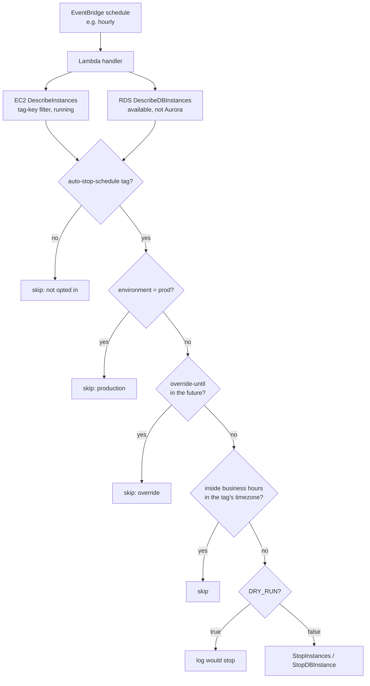

# Scheduled stop for non-production EC2 and RDS

An AWS Lambda function, run by an EventBridge schedule, that stops opted-in
non-production EC2 and RDS instances outside their business hours. Each
resource carries its own schedule and timezone in a tag, and can be given a
temporary override so it stays up during late work.

> **Status:** schedule parsing, DST handling, override expiry, opt-in and
> production protection, dry-run, pagination and error reporting are unit
> tested against hand-written fake EC2/RDS clients (47 tests). The IAM
> policy is checked by a structural test but has **not** been evaluated by
> IAM. Nothing has been deployed or run against a real account. The
> function only **stops**; starting instances again is not implemented.

## Problem

> Implement a Lambda that automatically stops non-production EC2/RDS
> instances outside business hours based on tags and schedules (with
> override protection).

Why it matters: non-production instances left running at night and at
weekends are paid for while nobody uses them. Stopping them on a schedule
each resource declares, with an override for late work, cuts that cost
without getting in anyone's way.

## How it decides



A bad tag value (unparseable schedule, unknown timezone, override without
an offset) never leads to a stop. It is recorded as an error, the rest of
the fleet is still processed, and the invocation then fails with the list
of bad resources so it shows up in Lambda error metrics.

## Tags

| Tag | Example | Meaning |
|---|---|---|
| `auto-stop-schedule` | `mon-fri 08:00-18:00 Europe/London` | Opt-in. Days (range or comma list), a same-day window, and an IANA timezone. The resource should run inside the window and is stopped outside it. |
| `auto-stop-override-until` | `2026-11-20T22:00:00Z` | Optional. ISO 8601 **with** offset. Until then, the resource is left alone. Once it passes, the schedule applies again. |
| `environment` | `prod` / `production` | Never stopped, even with a schedule tag. Case-insensitive. |

Resources without `auto-stop-schedule` are never touched. For EC2 the tag is
also a server-side filter; for RDS it is checked in code because
`DescribeDBInstances` can't filter on tags.

### Time and DST

The handler takes "now" from the EventBridge event's `time` field (falling
back to the clock), then converts it into the tag's timezone with
`zoneinfo`. The window is compared on local wall-clock time, so `08:00` in
`Europe/London` means 08:00 GMT in winter and 08:00 BST in summer. The tests
cover both 2026 London changes and the US spring change. Window start is
inclusive, end is exclusive. Overnight windows (`22:00-06:00`) are not
supported and are rejected; that was the simpler choice.

## Usage

```bash
python -m pip install -r requirements-dev.txt
python -m ruff check .
python -m ruff format --check .
python -m pytest -q
```

Deployment is not included. To deploy by hand you would:

- package `scheduler/` with `tzdata` (in `requirements.txt`, so timezone
  data does not depend on the runtime image);
- set the handler to `scheduler.handler.lambda_handler`, runtime Python
  3.12;
- attach `iam/policy.json` to the function role;
- create an EventBridge rule such as `cron(0 * * * ? *)` targeting it.
  `events/scheduled-event.json` shows the event shape the handler expects.

| Env var | Default | Meaning |
|---|---|---|
| `DRY_RUN` | `true` | Only log what would be stopped. Set `false` to act. Any other value is an error. |

The handler returns and logs a JSON summary: `stopped`, `would_stop`,
`skipped` (with reasons) and `errors`.

## IAM (`iam/policy.json`)

- `Describe*` on `*` (these calls don't support useful resource scoping).
- `ec2:StopInstances` and `rds:StopDBInstance` only on resources that carry
  the `auto-stop-schedule` tag, in account `123456789012` (placeholder).
- An explicit `Deny` on both stop actions for `environment=prod|production`,
  so a code bug still can't stop production.
- Logs only to its own log group. No start, terminate, or delete actions.

## Limits

- **RDS restarts by itself.** AWS starts a stopped RDS instance again
  automatically after 7 days. A long-idle database will come back up and
  then be stopped on the next run outside hours. _AWS behaviour to
  re-verify against current RDS documentation._
- Aurora cluster members are skipped (Aurora is stopped per cluster, not per
  instance). Instances that RDS refuses to stop, such as read replicas,
  surface as errors.
- Only stops. Morning start-up is not implemented.
- One region per function (the region of the boto3 clients).
- Stop calls are one per resource; fine for tens of resources, not tuned
  for thousands.

## Security notes

- Opt-in by tag plus an IAM deny on production: two independent guards.
- Dry-run is the default; a misconfigured deploy logs instead of acting.
- No credentials in code; the Lambda role supplies them.
- Anyone who can edit tags can opt a resource in or set an override. Limit
  `ec2:CreateTags` / `rds:AddTagsToResource` on these keys if that matters.

## Idempotency

Safe to re-run. Only `running` EC2 and `available` RDS instances are
considered, so already stopped or stopping resources are not called again.
Running twice in the same hour gives the same decisions.

## Layout

```
scheduler/schedule.py   tag parsing, business hours, decide()
scheduler/resources.py  EC2/RDS listing with pagination, stop calls
scheduler/handler.py    Lambda entry point, DRY_RUN, summary, error policy
iam/policy.json         least-privilege role policy
events/scheduled-event.json  sample EventBridge event
tests/                  fakes and tests
```
